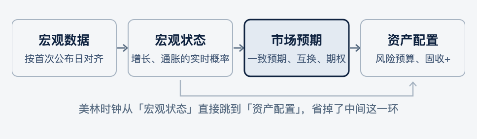
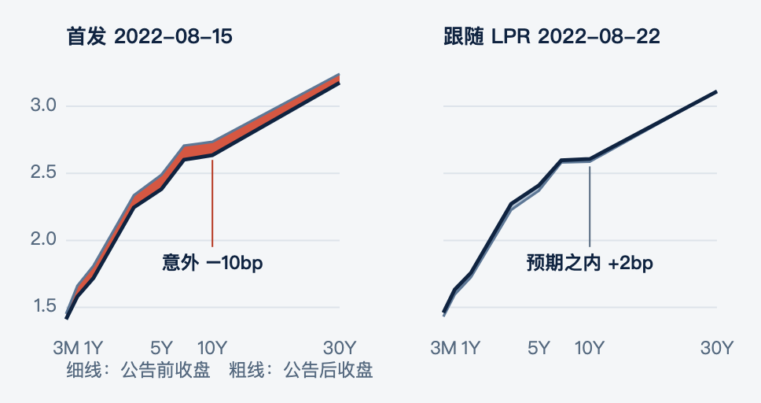
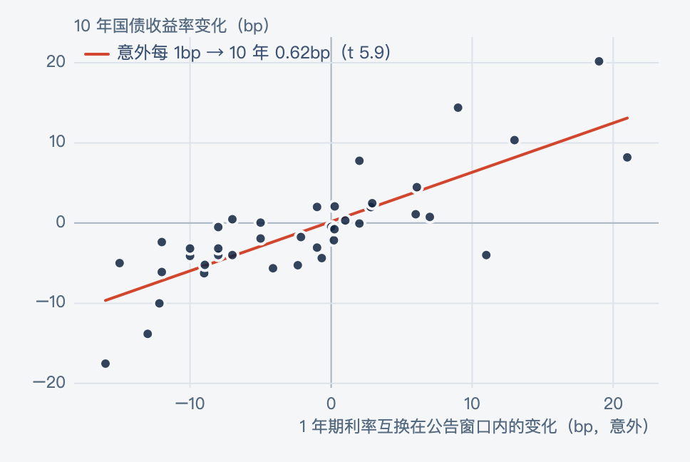
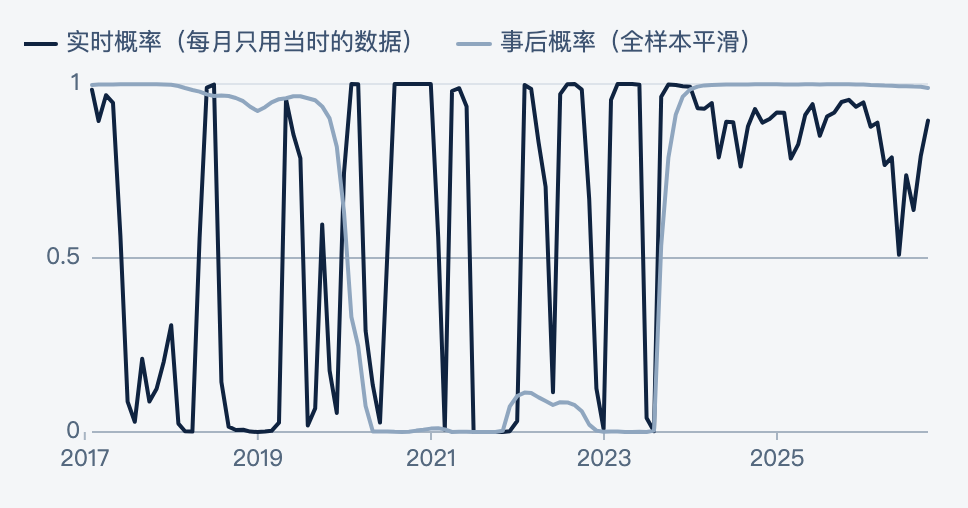
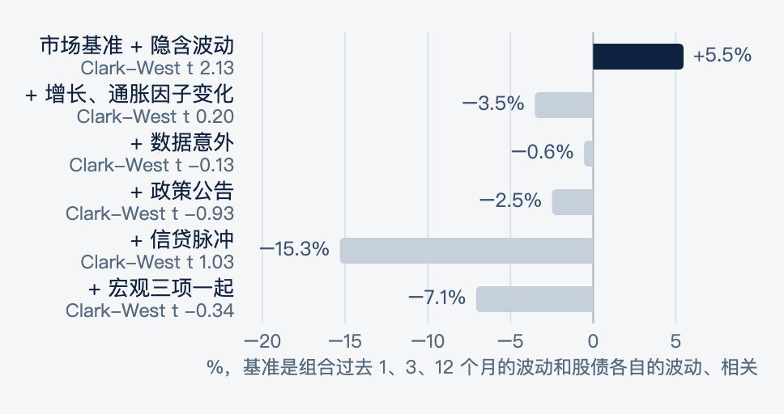
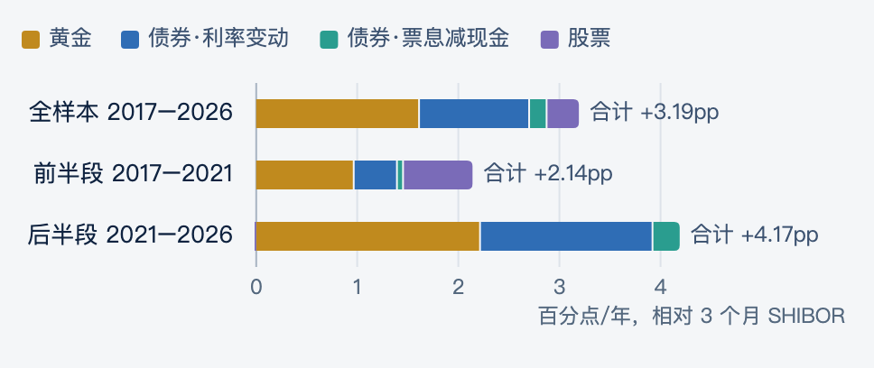

# macro-rates-research

**宏观信息在市场价格之外，能给固收+ 组合带来什么增量？** 这是这项研究的代码、测试和汇总结果。结论和图在网站上：[joyzen2.github.io](https://joyzen2.github.io)。

## 结论

宏观信息要和市场已经反映的预期比，才谈得上增量。

- **择时**：宏观状态的实时概率判断不准（Brier 分数 0.39，比一直猜 50% 的 0.25 还差）；等到实时确认的时候行情已经走完，之后 6 个月股票平均反向 5.5%。
- **利率**：价格只对「意外」反应。用 1 年期利率互换度量的政策意外每 1bp，带动 10 年国债 0.62bp（t 5.9），预期之内的部分没有影响；增长类数据每超预期 1 个标准差，1 年期互换上行 1.2–1.6bp。
- **风险**：预测固收+（债 80% + 股 20%）组合下个月的波动，期权隐含波动有增量（样本外 R² +5.5%，Clark-West t 2.1），宏观变量都没有。
- **配置**：风险预算组合扣无风险夏普 1.0–1.1，远好于股债 60/40 的 0.29；但超额收益一半来自黄金、四成来自债券，不是来自宏观判断。



### 利率只为意外定价

2022 年 8 月 15 日首发降息，整条国债曲线下移约 10bp；一周后跟随的 LPR 下调，曲线没有再往下走。把 40 次调息公告前后 1 年期利率互换的变化当作意外，意外每 1bp 带动 10 年国债 0.62bp。





### 宏观状态择时不灵

实时概率在 0 和 1 之间频繁跳动，事后状态十年只切换两次；确认切换后 6 个月，股票按信号方向平均反向 5.5%。



### 有增量的是期权，不是宏观



### 风险预算的收益从哪来



## 代码结构

| 模块 | 内容 |
| --- | --- |
| `datalayer` | 30 个公开宏观指标的登记表、发布滞后规则、按首次公布日对齐的实时面板 |
| `sources`、`probe_util` | 公开数据接口（经 akshare）和本地缓存 |
| `state` | 扩张窗口稳健标准化、每类指标的实时 PCA、增长和通胀两个维度、四象限概率 |
| `regime` | 两状态马尔可夫区制模型：贝叶斯滤波（实时）和全样本平滑，状态切换 |
| `cycles`、`evaluate` | Bry-Boschan 参考周期、拐点捕捉的评估和安慰剂 |
| `riskbudget`、`allocation` | Ledoit-Wolf 协方差、风险预算求解（cvxpy）、换手和成本约束、配置回测、平移安慰剂 |
| `policy`、`policy_rates` | 央行政策公告的事件研究，调息按 30 天规则分成首发和跟随 |
| `policy_irs` | 用利率互换度量政策意外、Kuttner 分解、数据意外对利率互换的影响 |
| `surprise_nbs`、`surprise_cpi` | 数据意外：几家财经日历的一致预期拼接、发布窗口、稳健性 |
| `credit`、`credit_bis` | 信贷脉冲（贷款、社融、BIS 总信贷口径） |
| `nowcast` | 混频动态因子模型做 GDP 实时预测，只用当时已公布的数据 |
| `curve` | Nelson-Siegel 收益率曲线因子，以及政策公告前后曲线怎么动 |
| `rerun` | 实时估计的泰勒规则、结构突变检验 |
| `attribution` | 择时失败按「识别—映射—定价—执行」逐环归因；风险预算的收益和风险来源 |
| `volforecast` | 期权合成 30 天隐含波动；固收+ 组合下月波动的样本外预测和波动目标管理 |
| `liquidity` | 资金面：DR001/DR007、回购定盘利率、SHIBOR 和政策利率的距离；从快讯解析央行每天的逆回购操作，按之前的操作推算到期量，每周和快讯报的净投放核对 |

## 测试

```bash
uv sync
uv run pytest -q
```

31 个测试，检查的是最容易出错的地方：实时面板只用当时已经公布的数据，PMI 按实际发布日判断，PCA 只用过去的数据、方向不乱翻，区制模型的结果可以复现，风险预算在方差很小时也解得出来，调息分组的 30 天规则，Nelson-Siegel 能还原已知的因子，数据意外的窗口处理收盘后和周末发布，隐含波动按方差插值到 30 天，组合权重在月内漂移、月初再平衡，快讯里央行操作的各种说法都能解析、到期量推算遇假期顺延、每周净投放和快讯报的对得上。需要本地数据的 6 个测试，在没有数据的时候自动跳过。

## 结果

`results/` 里是汇总结果，网站上引用的数字都能在这里找到，比如：

- `attribution_16A_*.csv`：择时逐环归因；`attribution_16B_*.csv`：风险预算的收益和风险来源
- `policy_irs_kuttner.csv`、`policy_irs_groups.csv`、`surprise_irs.csv`：政策意外和数据意外
- `volforecast_tests.csv`、`volforecast_vol_target.csv`：组合波动预测
- `allocation_summary*.csv`、`allocation_placebo*.csv`：配置回测和安慰剂
- `nowcast_scores.csv`、`curve_q*.csv`、`credit_impulse_*.csv`、`taylor_rule.csv`：其余专题
- `liquidity_weekly.csv`、`liquidity_omo_daily.csv`：资金面的周度均值、央行每天的逆回购操作和到期量（每天的资金利率是中国外汇交易中心的数据，不重新发布）

`docs/figures/` 是网站上的图（`svg/`、`png/`）和画图脚本。

## 数据（不在仓库里）

- **公开接口的数据**：国家统计局、东方财富、中债等，第一次运行时经 akshare 下载，缓存在 `data/raw/`。
- **学校 CSMAR 数据库的数据**：利率互换成交利率、2012–2014 年的社融、期权数据，以及 2005–2007 年几项宏观指标的历史，有版权，放在 `data/manual/`，不公开。用这些数据逐条算出来的结果（每次公告的利率互换变化、每月的隐含波动）也不放。
- **其他外部数据**：第一轮缓存的国债收益率和金十一致预期、3 个月 SHIBOR、指数行情，默认放在 `data/external/`，也可以用环境变量 `MACROB_EXTERNAL` 指到别处。
- 财经日历的一致预期属于这些网站，不重新发布。

## 时间线

框架是 2025 年实习时搭的。这里的代码是实习结束后，用公开数据和学校 CSMAR 数据库从头重建、延伸的，不含实习单位的任何数据和代码。检验规则和参数在看结果之前写定；看完结果后发现的设计问题，改了都写明是修正，修正前的结果留着。
